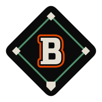

<p align="center">
  <picture>
    <source media="(prefers-color-scheme: dark)" srcset="docs/assets/birdland-mark-light.svg">
    
  </picture>
</p>

# Birdland

A modular, highly customizable desktop shell suite built with
[Quickshell](https://github.com/outfoxxed/quickshell) and managed entirely
through Nix Flakes and Home Manager. Designed with native support for the
[Niri](https://github.com/YaLTeR/niri) compositor and dynamically themed via
[base24-themes](https://github.com/chrisppy/base24-themes).

> [!NOTE]
> Birdland is in its early days. Expect rough edges, and options and behavior
> that may change between versions.

**[Usage & configuration options →](./docs/usage.md)**

**[Theming →](./docs/theming.md)**

## Components

Birdland is split into eight Quickshell applications, which can be used
individually or as a complete suite:

- **[`bullpen`](./docs/bullpen.md)**: A status bar on every monitor, attachable
  to any screen edge (`top`, `bottom`, `left`, `right`), with that monitor's
  workspaces, the focused window, a clock, the media player, tray icons, and
  status indicators for CPU, memory, GPU, temperature, weather, network, volume,
  microphone and battery.
- **`dugout`**: A quick application launcher that opens on the focused monitor.
- **`lineup`**: A dock of favorite and running apps on every monitor.
- **[`outfield`](./docs/outfield.md)**: Wallpapers on every monitor: an image,
  or a folder that rotates, with optional per-monitor choices.
- **[`scoreboard`](./docs/scoreboard.md)**: Notification popups on the focused
  monitor.
- **[`jumbotron`](./docs/jumbotron.md)**: A pop-up on the focused monitor when
  the volume, microphone mute or screen brightness changes.
- **[`tarp`](./docs/tarp.md)**: A lock screen that locks on idle, before sleep
  and on `loginctl lock-session`, and turns the monitors off when idle.
- **[`gate`](./docs/gate.md)**: A login screen for greetd, set up through the
  NixOS module, with a user list, session list and power buttons.

Dugout and Lineup start apps through Niri, so each app runs in its own systemd
scope: restarting either service (Home Manager does when it changes) leaves the
apps open.

______________________________________________________________________

## Installation

Add Birdland as an input to your `flake.nix`:

```nix
{
  inputs = {
    nixpkgs.url = "github:NixOS/nixpkgs/nixos-unstable";
    
    birdland.url = "github:chrisppy/birdland";
    # birdland.inputs.base24-themes.follows = "base24-themes";
  };

  outputs = { self, nixpkgs, birdland, ... }@inputs: {
    # Your flake outputs...
  };
}
```

## Development

The dev shell can run any app straight from the checkout, and Quickshell reloads
it as you edit:

```sh
just dev                               # enter the dev shell
qs -p apps/bullpen                     # run an app
BULLPEN_POSITION=left qs -p apps/bullpen
BULLPEN_LEFT=clock BULLPEN_CENTER=workspaces BULLPEN_RIGHT=cpu,volume qs -p apps/bullpen
BULLPEN_WEATHER_LOCATION=39.28,-76.62 qs -p apps/bullpen
BULLPEN_RIGHT=feeds,clock qs -p apps/bullpen   # needs a paired pressbox
LINEUP_FAVORITES=firefox,foot qs -p apps/lineup
OUTFIELD_WALLPAPER=~/Pictures/Wallpapers OUTFIELD_INTERVAL=1 qs -p apps/outfield
qs -p apps/tarp &  qs -p apps/tarp ipc call tarp lock   # your password unlocks it
```

Gate needs greetd to log in; run outside it, it shows a warning and the screen.

Entering the shell generates the default theme into
`modules/theme/Base24Colors.qml` (gitignored) and puts the repo root on
`QML2_IMPORT_PATH`, so `import modules.theme` resolves.

## License

This project is licensed under the **GPL-3.0-only** license. See the
[LICENSE](./LICENSE) file for details.
